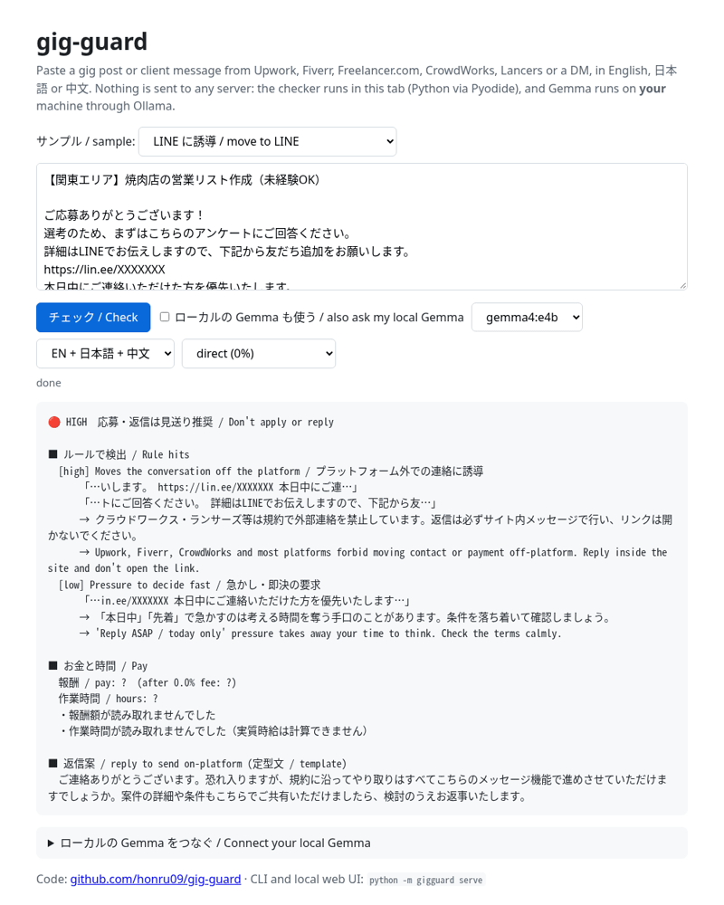

# gig-guard

**A scam & fit check for freelance gigs, on any platform, in English, 日本語 or 中文.**
Paste a job post or a client message from Upwork, Fiverr, Freelancer.com, CrowdWorks, Lancers, Coconala or a
cold DM. Gemma tells you whether it's a scam, **quotes the exact line that gives it away**, works out what the
job really pays per hour after the platform's cut, and drafts a reply that keeps you on the platform.
Everything runs on your own machine.

**▶ Try it in your browser:** https://honru09.github.io/gig-guard/
(rules + pay math run in the tab; connect your local Gemma for the full check)



## One command

```bash
ollama pull gemma4:e4b
git clone https://github.com/honru09/gig-guard && cd gig-guard
python -m gigguard serve                          # http://127.0.0.1:8765
python -m gigguard --platform upwork check post.txt
```

Python 3.10+, no dependencies. `--no-llm` gives the rule and pay checks instantly without a model.

| Flag | |
|---|---|
| `--platform` | fee preset: `direct` 0%, `upwork` ~10%, `fiverr` 20%, `freelancer` 10%, `crowdworks` 20%, `lancers` 16.5%, `coconala` 22% (approximate, fees change) |
| `--fee 0.15` | custom fee, overrides the preset |
| `--min-hourly 25` | your floor in the post's currency (defaults: $10, ¥1,200, 25 CNY) |
| `--lang en\|ja\|zh\|both\|all` | report language |
| `--model gemma4:e2b` | any Ollama model; `check --json` for scripting |

## How it works

```
 post ──► rule layer (regex, EN/JA/ZH) ─────────┐
   ├────► pay math ($ / 円 / 元, hourly, fees) ──┤──► verdict: can only be escalated
   └────► Gemma (local, JSON) ──► findings ──► quote check ──┘
                                   each with an exact quote,
                                   reasons in EN / JA / ZH
```

1. **Rules** catch the textbook red flags with zero latency, in three languages: moving contact or payment off
   the platform (WhatsApp, Telegram, WeChat, LINE, "outside Upwork to avoid the fees"), paying to get work
   (deposits, starter kits, 培训费, 教材費), unpaid tests and free samples, early ID / SSN / bank requests,
   crypto pitches, "earn $500 a day" bait, rush pressure, and "no AI" clauses.
2. **Gemma reads the post cold** (it is not shown the rule hits) and returns structured findings: category,
   severity, an **exact quote from the post**, and reasons in English, Japanese and Chinese, plus a summary
   and questions to ask the client. This is where the scams that avoid the textbook words get caught: parcel
   reshipping, buying bank or social-media accounts, paid fake reviews, "let's deal directly", "test article is
   unpaid but you'll get regular work".
3. **Quote grounding.** Every quote is checked against the post (NFKC, ignoring whitespace and punctuation).
   A finding whose quote is not in the post is dropped and shown as rejected. Only grounded findings can
   raise the risk; Gemma's overall "risk" field on its own changes nothing.
4. **One-way safety.** Rules are facts in the text; the model can never lower a rule hit. Once anything at
   medium or above fires, the suggested reply is a fixed, reviewed template in the post's language, because
   small models tend to be polite to a fault (one draft cheerfully agreed to do an unpaid trial).

## Which Gemma? A small, honest eval

`eval/fixtures.jsonl`: 20 hand-written gig posts (14 risky, 6 normal). This first set is Japanese, where the
project started; six of the risky posts avoid the words the rules look for. The rules were written before the
set and not tuned on it. 8-core CPU, no GPU, Q4_K_M, `python eval/run_eval.py --models …`.

| Config | Risky posts flagged | Safe posts false-flagged | Expected categories found | Caught only thanks to Gemma | Valid JSON | Findings with quote verified / rejected | Median s/post (CPU) |
|---|---|---|---|---|---|---|---|
| rules only | 8/14 | 1/6 | 7/15 | 0 | – | – | – |
| rules + gemma3:1b | 8/14 | 2/6 | 11/15 | 0 | 19/20 | 56 / 5 | 10.1 |
| rules + gemma3:4b | 14/14 | 1/6 | 11/15 | 6 | 20/20 | 13 / 0 | 32.2 |
| rules + gemma4:e2b | 12/14 | 1/6 | 12/15 | 4 | 20/20 | 23 / 0 | 27.9 |
| rules + gemma4:e4b | 14/14 | 1/6 | 12/15 | 6 | 20/20 | 19 / 0 | 29.9 |
- "Caught only thanks to Gemma" = risky posts the rules alone did not flag.
- All 5 rejected quotes came from Gemma 3 1B (e.g. 「投資はしません。」 on a transcription job, a sentence nobody
  wrote). The quote check stopped every one.
- The one false flag in every row is the rules' fault: a normal job running a restaurant's "LINE公式アカウント"
  trips the LINE rule, and by design the model can't clear a rule hit.
- 20 posts is a sanity check, not a benchmark. English and Chinese posts are covered by unit tests and
  `samples/07–10`; an English eval set is the obvious next step. Per-post output: `eval/results.json`.

## Privacy

Client messages contain names, business details and sometimes things nobody should have sent. gig-guard never
sends them anywhere: the CLI and local web UI talk only to Ollama on `127.0.0.1`, and the browser demo runs the
same Python code in the tab (Pyodide) and calls your local Ollama directly
(`OLLAMA_ORIGINS=https://honru09.github.io ollama serve`).

## Tests

```bash
python -m unittest discover -s tests -v   # no model or network needed
```

Rules in three languages (including "online" / オンライン / ガイドライン *not* being read as LINE), pay
parsing in $ / 円 / 元, fee presets, messy model JSON, quote grounding, the escalation-only contract, reply
safety and language, the CLI, the local web UI, and that the browser copy of the code is in sync
(`python tools/sync_web.py`).

## Limits

- Scam phrasing changes fast; neither the rules nor a 4B model catch everything.
- Fee presets are approximate; check your platform and pass `--fee`.
- A second opinion, not legal advice. When in doubt, ask the platform's support.

## License

MIT
